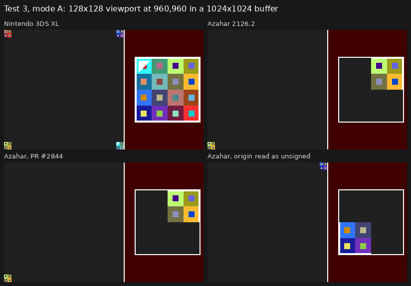
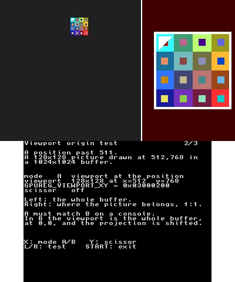
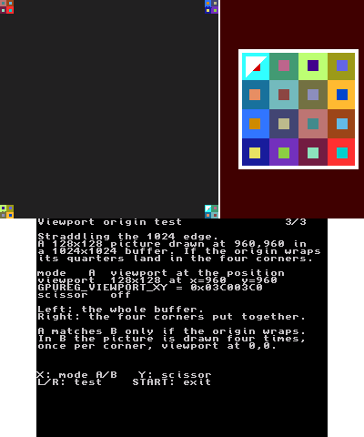
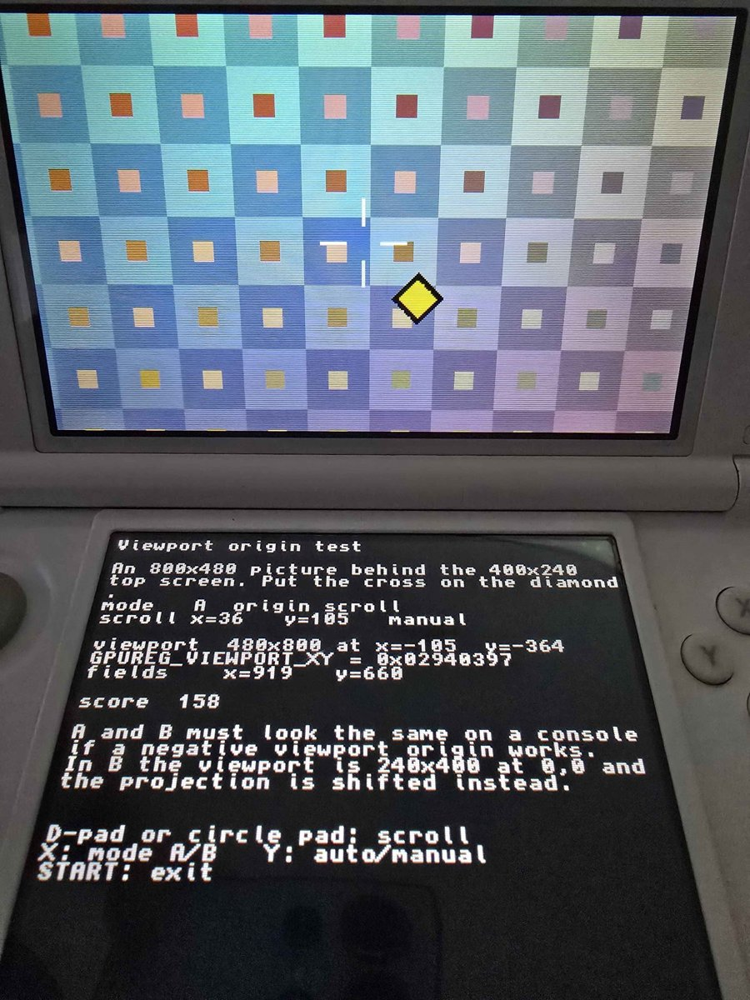
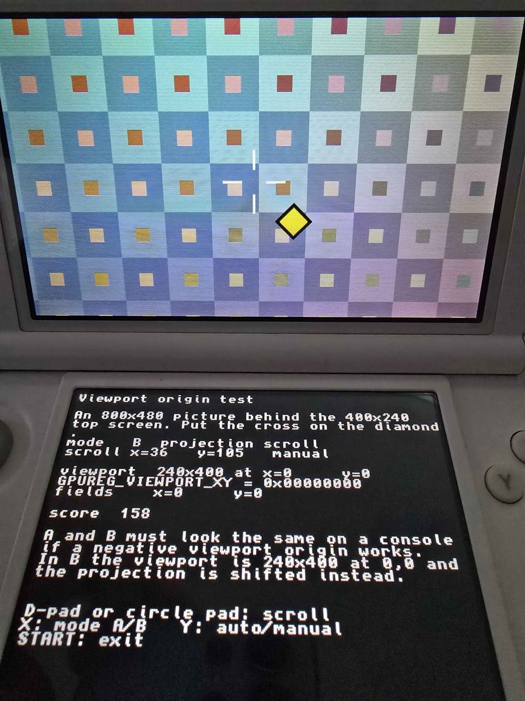
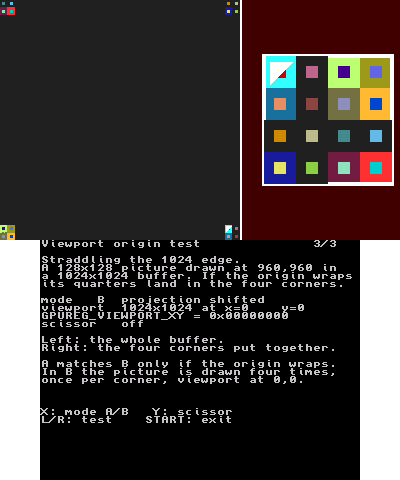
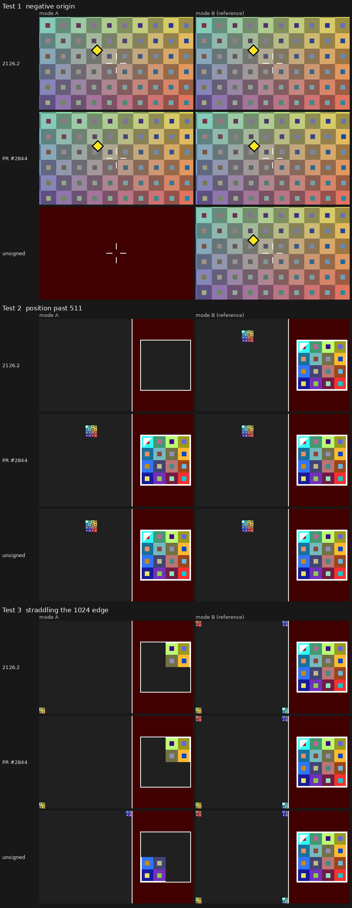

# Viewport origin test

A 3DS homebrew with three tests of what the console does with the origin in `GPUREG_VIEWPORT_XY`, which has ten bits per axis.

`vporigin.3dsx` is in the [latest release](../../releases/latest).

Every test has two modes. Mode A uses the origin under test. Mode B draws the same pixels with the viewport at 0,0: the reference. D-pad left and right pick the test, X switches the mode.

## The tests

**1. A negative origin.** An 800x480 picture sits behind the 400x240 top screen. The aim is to put the cross on the diamond; each hit moves the diamond. Left alone, it plays itself. In mode A the viewport is 480x800, the picture always fills it, and scrolling moves the viewport origin, which is 0,0 at the start and negative everywhere else. The scissor is the 240x400 framebuffer. The bottom screen shows the origin and the register, for example `viewport 480x800 at x=-156 y=-172`, `GPUREG_VIEWPORT_XY = 0x03540364`. In mode B the viewport is 240x400 at 0,0 and the projection is shifted instead.

**2. A position past 511.** A 128x128 picture is drawn at 512,768 into a 1024x1024 off-screen buffer (`GPUREG_VIEWPORT_XY = 0x03000200`). The top screen shows the whole buffer on the left and the place where the picture belongs, at 1:1, on the right. In mode B the viewport is the whole buffer and the picture's vertices are moved to 512,768.

**3. Straddling the 1024 edge.** The same picture at 960,960 (`GPUREG_VIEWPORT_XY = 0x03C003C0`), so it crosses the 1024 edge on both axes. If the origin wraps at ten bits, the four quarters of the picture land in the four corners of the buffer. The top screen shows the whole buffer on the left and the four corners put back together on the right. In mode B the viewport is the whole buffer and the picture is drawn four times, once per corner, each copy cut to the buffer.

## Reading the result

| Test | Mode A on the console | Meaning |
|---|---|---|
| 1 | same as B | a negative origin works |
| 1 | dark red with only the cross, except at the start | the field is plain unsigned |
| 2 | same as B | an origin past 511 is a position |
| 2 | empty frame | the field is plain signed |
| 3 | whole picture, same as B | the origin wraps at ten bits, pixel by pixel |
| 3 | upper right quarter only | read as -64,-64; the part below 0 is cut |
| 3 | lower left quarter only | read as 960,960; the part past 1023 is cut |
| 3 | two quarters | the two axes behave differently |

In tests 2 and 3 mode B also checks the test itself: it must show the whole picture inside the frame.

Y in tests 2 and 3 turns on a scissor that covers the whole buffer, 0,0 to 1024,1024. If that changes mode A, the scissor is tested before the wrap.

## Controls

| | |
|---|---|
| D-pad left / right | previous / next test, starting in mode A |
| X | mode A / B |
| Y | test 1: automatic / manual. Tests 2 and 3: scissor off / on |
| Circle pad | test 1: scroll (switches to manual) |
| START | exit |

L, R, SELECT and D-pad up and down do nothing, so the Rosalina shortcut (L + D-pad down + SELECT) moves nothing.

Six screenshots cover everything: each test in mode A and in mode B. In test 1, press Y first so the picture stands still.

## On a console

Nintendo 3DS XL (SPR-001), v1.1:

| Test | Mode A on the console |
|---|---|
| 1 | the picture, as in mode B: a negative origin works |
| 2 | the picture at 512,768; the 1:1 view is the expected picture pixel for pixel: an origin past 511 is a position |
| 3 | the whole picture in the four corners; the 1:1 view is the expected picture pixel for pixel: the origin wraps |

So the origin is neither signed nor unsigned. It is added modulo 1024, pixel by pixel, and a viewport that crosses the 1024 edge comes out on both sides of the buffer.



| Test 2, mode A | Test 3, mode A |
|---|---|
|  |  |

Test 1 in both modes, v1.0:

| Mode A | Mode B |
|---|---|
|  |  |

### The far edge of a 1024 viewport

In v1.1 the reference of test 3 used triangles that touched or crossed the far edge of the 1024x1024 viewport. The console dropped every one of them whole, on both axes, where Azahar draws them; triangles crossing the near edge were clipped as expected. Mode B came out with holes:



The 240x400 viewport of test 1, mode B, clips at its far edge without trouble, so this belongs to the 1024 size.

Since v1.2 the references keep a quarter of a pixel away from the far edge. v1.2 has not been run on a console yet.

## Azahar

| Build | Test 1, mode A | Test 2, mode A | Test 3, mode A |
|---|---|---|---|
| 2126.2 (origin read as signed) | same as B | empty frame | upper right quarter |
| [PR #2844](https://github.com/azahar-emu/azahar/pull/2844) | same as B | same as B | upper right quarter |
| origin read as unsigned | blank except at the start | same as B | lower left quarter |

The scissor changes nothing on any of the three.



## Building

devkitARM with libctru and citro3d:

```
make
```

gives `vporigin.3dsx`.
